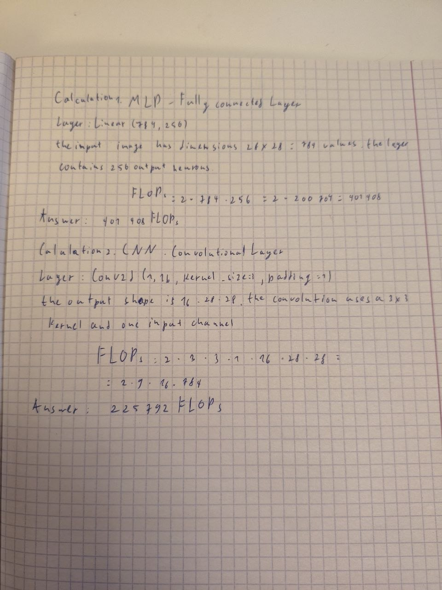
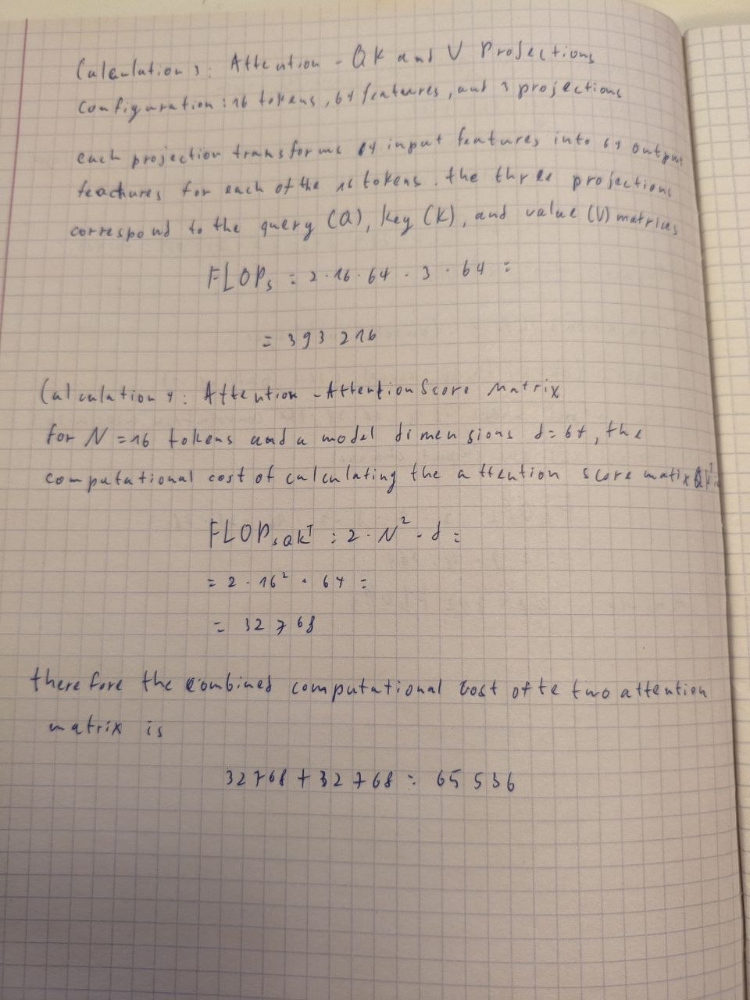

# Lab 3: Architectures and their costs

## Objective
Implement comparable MLP, CNN, and attention architectures in PyTorch,
measure parameter counts, FLOPs/MACs and inference latency, train for five
epochs, and compare accuracy against computational cost.

## Experimental setup
- Dataset: Fashion-MNIST; official training set split into 55,000 train and 5,000 validation examples; official 10,000-example test set.
- Transform: `ToTensor()` then `Normalize((0.2860,), (0.3530,))`.
- Batch size: 128; optimizer: Adam; learning rate: 0.001; epochs: 5.
- Device used: `cpu`; random seed: 42.
- Inference latency is measured after 10 warm-up runs; median of 100 runs for batch 1 and 20 runs for batch 128.

## Architecture and parameter counts
| Model | Trainable parameters | Test accuracy | Batch-1 median (ms) | Batch-128 median (ms) |
|---|---:|---:|---:|---:|
| MLP | 235,146 | 88.1300% | 0.048 | 0.175 |
| CNN | 20,490 | 89.7900% | 0.088 | 3.102 |
| Attention | 70,794 | 83.9400% | 0.226 | 1.544 |

### Important specification note
The handout asks for models targeting 100k–150k parameters but also gives fixed layer definitions.
Those definitions do not all fall in that range: the prescribed MLP and CNN parameter counts differ substantially.
This implementation follows the explicit layer definitions rather than silently changing them. Mention this conflict to the instructor if the target range is mandatory.

## Handwritten calculations

Insert your own handwritten calculation photos below. The code preserves this section when generating the final report.

### Page 1 — MLP and CNN calculations

### Page 2 — Attention calculations

Convention used: one multiply-add is counted as 2 FLOPs.
| Layer / operation | Calculation | FLOPs |
|---|---|---:|
| MLP first Linear | 2 × 784 × 256 | 401,408 |
| CNN first Conv2d | 2 × 3 × 3 × 1 × 16 × 28 × 28 | 225,792 |
| Attention QKV projections | 2 × 16 × 64 × 3 × 64 | 393,216 |
| Attention score products | 2 × 16² × 64 | 32,768 |

These are representative operations, not total-model FLOPs. Bias additions, activations, normalization, pooling and other operations are omitted from these hand calculations.

## THOP comparison
- **MLP:** THOP reports 234,752 MACs for batch 1 (approximately 469,504 FLOPs under the 2-FLOPs-per-MAC convention); THOP parameter count: 235,146.
- **CNN:** THOP reports 1,031,744 MACs for batch 1 (approximately 2,063,488 FLOPs under the 2-FLOPs-per-MAC convention); THOP parameter count: 20,490.
- **Attention:** THOP reports 591,488 MACs for batch 1 (approximately 1,182,976 FLOPs under the 2-FLOPs-per-MAC convention); THOP parameter count: 37,514.

THOP commonly reports multiply-accumulate operations (MACs), not FLOPs. To compare consistently, convert using approximately 2 FLOPs per MAC. Differences from hand calculations are expected because the manual calculations cover only selected operations, while profilers may include or omit biases, normalization, pooling, activations, and unsupported operators. Transformer operator coverage can vary by profiler version.

## Training results
### MLP

| Epoch | Train loss | Validation loss | Validation accuracy |
|---:|---:|---:|---:|
| 1 | 0.4905 | 0.3912 | 85.8800% |
| 2 | 0.3518 | 0.3568 | 87.2600% |
| 3 | 0.3139 | 0.3450 | 86.9800% |
| 4 | 0.2872 | 0.3276 | 88.0400% |
| 5 | 0.2689 | 0.3137 | 88.4600% |

### CNN

| Epoch | Train loss | Validation loss | Validation accuracy |
|---:|---:|---:|---:|
| 1 | 0.5083 | 0.3840 | 86.4000% |
| 2 | 0.3364 | 0.3443 | 87.6000% |
| 3 | 0.2976 | 0.3164 | 88.7800% |
| 4 | 0.2738 | 0.2852 | 89.8000% |
| 5 | 0.2552 | 0.2801 | 89.9000% |

### Attention

| Epoch | Train loss | Validation loss | Validation accuracy |
|---:|---:|---:|---:|
| 1 | 0.8439 | 0.6138 | 78.6200% |
| 2 | 0.5508 | 0.5428 | 80.5400% |
| 3 | 0.4840 | 0.4933 | 82.4000% |
| 4 | 0.4516 | 0.4890 | 82.9400% |
| 5 | 0.4241 | 0.4519 | 83.4800% |

## Plots
- `results/accuracy_vs_parameters.png` — test accuracy against parameter count.
- `results/accuracy_vs_latency.png` — test accuracy against batch-1 latency.
- `results/validation_accuracy_by_epoch.png` — validation accuracy across epochs.

## Discussion: access patterns and cost-effectiveness
The MLP flattens the image, discarding explicit 2D neighborhood structure. Its dense matrix multiplications can be regular and hardware-friendly, but the specified hidden layers lead to a comparatively large parameter count.
The CNN uses local receptive fields and weight sharing, exploiting image locality and translation-related patterns. Its parameter count is comparatively small, although convolution performance depends on implementation, memory layout, and hardware kernels.
The attention model processes sixteen patches and uses pairwise token interactions. Its attention-score work grows quadratically with sequence length, while projections and feed-forward layers also contribute substantial cost. With only sixteen patches, the sequence is short, but Transformer operations may have higher runtime overhead than simpler layers.
Cost-effectiveness should be judged from the measured test accuracy, parameter count, and latency together; the most accurate model is not automatically the fastest or smallest. Use the tables and plots above to state which model gives the best accuracy-cost trade-off on the machine used.

## Reproducibility notes
Results depend on PyTorch/torchvision versions, CPU/GPU hardware, and runtime conditions. The script records the device and seed. Latency values are local measurements and should not be compared across machines without noting hardware and software versions.

## Conclusion
Replace this paragraph with a concise conclusion based on the measured values above: identify the strongest test accuracy, smallest parameter count, lowest batch-1 latency, and the best overall trade-off.
